# twilight

A local-engines front desk: a Rust MCP server that detects, catalogs,
and drives the local model engines on a machine — built stage by stage
toward full studio parity (the Slice C program). Stage A1 (core server
+ engine detection) is gated and live on the estate workstation; the
three A1 tools (`engine_detect`, `engine_health`, `twilight_info`)
are read-only.

## Progress

<!-- tracker:start -->

**22% — 6 of 27 gates closed — updated 2026-10-21.**
Full record: [CHECKLIST.md](CHECKLIST.md) — every item traces to a stage gate in the program documents; the bar moves only on gated evidence.
<!-- tracker:end -->

Progress here is tracked from ideation to the finished 1.0 and
beyond: each checklist item is a stage gate from the program
documents, and it closes only on verified evidence.

## Status of the source

The twilight source tree currently lives in the project's local tree
on the estate workstation (no remote, by design until now). This repo
is its public home and progress record first; the code mirror lands
as a separate gated step, and this README will say so plainly until
it does.

## License

Apache-2.0 — see [LICENSE](LICENSE).
